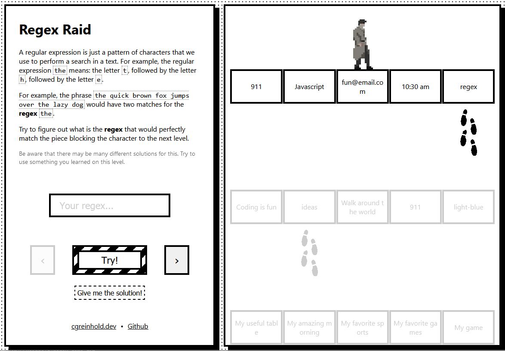

# Regex Mistery

Jogo criado para ensinar alguns conceitos de expressões regulares.

Tente descobrir qual é a regex necessária para avançar de nível e chegar até o fim.

Cada nível apresenta um desafio diferente de regex.

[Você pode testar a versão online aqui](https://regex-mistery.cgreinhold.dev/)

## Como usar

Abra `index.html` diretamente no navegador. Não é necessário instalar nada nem
rodar um servidor.

Os arquivos da página são:

- `index.html` — estrutura da página
- `style.css` — estilos
- `script.js` — níveis, lógica do jogo e interações
- `assets/` — imagens usadas pelo jogo

Se você encontrar algum bug ou problema, abra uma issue ou ajude a evoluir o
jogo enviando um PR.
